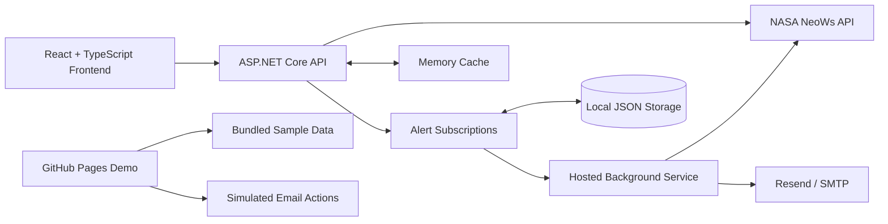
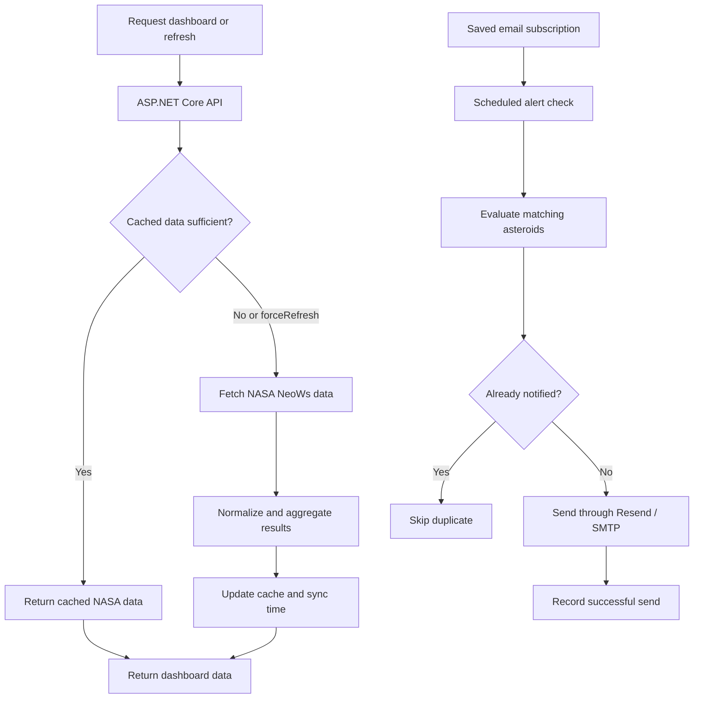

<div align="center">


# NearEarth

**Explore Near-Earth Objects, investigate close approaches, and track asteroids through an interactive dashboard.**

<p>
  <a href="https://avuii.github.io/NearEarth/">
    
  </a>
  
  <a href="LICENSE">
    
  </a>
</p>

<p>
  
  
  
  
  
</p>

**[Live Demo](https://avuii.github.io/NearEarth/)** · **[NASA NeoWs](https://api.nasa.gov/)** · **[Report an Issue](https://github.com/Avuii/NearEarth/issues)**

</div>

---

## Application Preview

<p align="center">
  <a href="https://github.com/user-attachments/assets/4a6ce557-6267-4185-a8a2-255503045016">
    
  </a>
</p>

<p align="center">
  <a href="https://avuii.github.io/NearEarth/"><strong>Open the interactive demo</strong></a>
</p>

The GitHub Pages demo uses bundled sample data and simulates email delivery in the browser. **Live NASA data and real email alerts require the ASP.NET Core backend** and the appropriate credentials.

## Table of Contents

- [Overview](#overview)
- [Key Features](#key-features)
- [Technology Stack](#technology-stack)
- [Architecture](#architecture)
- [Getting Started](#getting-started)
- [Configuration & API](#configuration--api)
- [Testing & Security](#testing--security)
- [Project Status & Roadmap](#project-status--roadmap)
- [License](#license)
- [Author](#author)

## Overview

**NearEarth** is a full-stack educational web application for exploring Near-Earth Objects (NEOs), their upcoming close approaches, and NASA's potentially hazardous asteroid (PHA) indicators.

The application combines **NASA NeoWs data**, interactive charts, asteroid details, a personal watchlist, a simplified 3D Solar System, and configurable alerts in one interface. The backend normalizes and caches NASA responses, aggregates a 30-day view from multiple requests, and manages automatic email alert checks.

It is designed for space enthusiasts, students, and users who want a more approachable way to explore asteroid data—not for issuing official hazard warnings.

> [!NOTE]
> The public GitHub Pages demo is a standalone sample-data experience. The full React frontend uses a separate ASP.NET Core API to retrieve live data and deliver configured notifications.

## Key Features

| Feature | Description | Availability |
| --- | --- | --- |
| **Dashboard** | 7-day and 30-day summaries, nearest and largest objects, relative velocities, PHA counts, recent alerts, and last successful data sync. | Full app; sample data in demo |
| **Flyby Explorer** | Search, sort, and filter upcoming approaches by proximity and potentially hazardous status; inspect distances, speeds, and diameters. | Implemented |
| **Asteroid Details** | NASA/JPL identifiers, diameter estimates, approach dates, miss distances, velocities, orbit class, and external source links. | Implemented |
| **Watchlist** | Save and remove selected asteroids; review their closest approaches and PHA indicators. | Browser `localStorage` |
| **Alerts** | Generate in-app alerts and configure distance, diameter, PHA, recipient, language, and per-check email limits. | Full app; simulated email in demo |
| **Automatic Email Checks** | Background subscription checks, send history, duplicate prevention, and last-check diagnostics. | Running backend and configured sender required |
| **Charts and Statistics** | Flybys over time, distance vs. date, and closest-approach comparisons. | Main charts use NASA data; Stats tab uses samples |
| **3D Solar System** | Simplified interactive space view, asteroid-belt reference, object focus, and fullscreen preview. | Educational visualization |
| **Search and Education** | Search asteroids, pages, and learning topics; read explanations in English and Polish. | Implemented |

### Alert Workflow

1. Choose a distance, estimated-diameter, or PHA-based rule in **Alerts**.
2. Add an email recipient, select a language, and set the per-check email limit.
3. Run an on-demand check or save an automatic alert subscription.
4. The background service evaluates saved subscriptions every **15 minutes by default**, while the backend is running.
5. Successful sends are recorded to prevent duplicate notifications to the same recipient.

Subscription data and successful-send history are currently stored in JSON files under `backend/NearEarth.Api/App_Data/`.

## Technology Stack

| Layer | Technologies | Purpose |
| --- | --- | --- |
| **Frontend** | React, TypeScript, Vite, Tailwind CSS | Dashboard and responsive interface |
| **Visualization** | Recharts, Three.js, Lucide React | Charts, 3D preview, interface icons |
| **Backend** | C#, ASP.NET Core Web API, `HttpClient` | API endpoints, NASA requests, alert management |
| **Caching** | `MemoryCache` | Reduce repeated NASA calls |
| **Background Processing** | ASP.NET Core hosted service | Scheduled checks of email subscriptions |
| **Persistence** | Browser `localStorage`, local JSON files | Watchlist, subscription data, send history |
| **Documentation** | Swagger / OpenAPI | Backend endpoint exploration |
| **External Data** | NASA NeoWs | Asteroid details and close approach data |
| **Email** | Resend or SMTP | Configurable outbound notifications |

**SQL database persistence and user authentication are not implemented.**

## Architecture

The full application uses the ASP.NET Core backend as a proxy for NASA NeoWs so the NASA API key is not exposed to the browser.



### Data and Alert Processing



### Repository Structure

```text
NearEarth/
├── backend/
│   ├── NearEarth.Api/
│   │   ├── Controllers/
│   │   ├── Models/
│   │   ├── Options/
│   │   ├── Services/
│   │   ├── Program.cs
│   │   └── appsettings.json
│   └── NearEarth.Api.Tests/
├── frontend/
│   ├── src/
│   │   ├── assets/
│   │   ├── components/
│   │   ├── lib/
│   │   ├── services/
│   │   └── types/
│   ├── tests/
│   ├── package.json
│   └── vite.config.ts
├── demo/
├── LICENSE
└── README.md
```

## Getting Started

### Prerequisites

- .NET 10 SDK
- Node.js 22.12 or later and npm
- A NASA API key from [NASA Open APIs](https://api.nasa.gov/)
- Optional: Resend or SMTP credentials for email delivery

> [!IMPORTANT]
> A fresh checkout is currently **not fully buildable**. Some backend C# model files were excluded from Git by a `models/` ignore rule, and the frontend production build has reported TypeScript error `TS5107` involving the legacy `moduleResolution` setting. The instructions below describe local development with a working source copy until these issues are resolved.

### 1. Clone the Repository

```bash
git clone https://github.com/Avuii/NearEarth.git
cd NearEarth
```

### 2. Configure the Backend

Store the NASA key with .NET User Secrets instead of committing it to configuration files.

```bash
cd backend/NearEarth.Api
dotnet user-secrets set "Nasa:ApiKey" "YOUR_NASA_API_KEY"
```

### 3. Start the API

```bash
dotnet restore
dotnet run --launch-profile http
```

The HTTP development profile serves the API at `http://localhost:5272` and Swagger at `http://localhost:5272/swagger`.

### 4. Configure and Start the Frontend

From another terminal, in the repository root, create `frontend/.env` containing:

```dotenv
VITE_API_URL=http://localhost:5272
```

Then run:

```bash
cd frontend
npm install
npm run dev
```

Open `http://localhost:5173`.

> [!TIP]
> The [GitHub Pages demo](https://avuii.github.io/NearEarth/) can be explored without installing the backend or configuring NASA and email credentials.

## Configuration & API

### Environment Configuration

| Setting | Location | Purpose |
| --- | --- | --- |
| `VITE_API_URL` | `frontend/.env` | URL of the local ASP.NET Core API |
| `Nasa:ApiKey` | Backend secrets | Private NASA NeoWs API key |
| `Email:Provider` | Backend secrets/configuration | `Resend` or `Smtp` |
| `Email:ResendApiKey` | Backend secrets | Resend credential |
| `Email:From` | Backend configuration | Sender email address |
| `Email:Smtp:Host` / `Email:Smtp:Port` | Backend configuration | SMTP server and port; example defaults `smtp.gmail.com:587` |
| `Email:Smtp:Username` / `Email:Smtp:Password` | Backend secrets | SMTP sender credentials |
| `Email:CheckIntervalMinutes` | Backend configuration | Automatic email check interval; default `15` |

In operating-system environment variables, replace configuration colons with double underscores (for example, `Nasa__ApiKey`). Configure an email provider before attempting real delivery; notification recipients are set from the Alerts page.

> [!IMPORTANT]
> Do not commit `.env`, API keys, email passwords, provider tokens, or locally saved alert recipients. Variables with the `VITE_` prefix are bundled into the frontend and **must not contain secrets**.

### Backend API

| Method | Endpoint | Purpose |
| --- | --- | --- |
| `GET` | `/api/dashboard` | 7-day dashboard summary |
| `GET` | `/api/dashboard/range?days=30` | 30-day aggregated dashboard data |
| `GET` | `/api/neos/feed?startDate=YYYY-MM-DD&endDate=YYYY-MM-DD` | NEO feed for a date range |
| `GET` | `/api/neos/{id}` | Asteroid details |
| `GET` | `/api/neos/browse?page=0&size=20` | Paginated NEO browsing |
| `POST` | `/api/alerts/check` | On-demand alert evaluation |
| `GET` | `/api/alerts/history` | Alert history |
| `POST` | `/api/alerts/subscriptions` | Create a subscription |
| `GET` | `/api/alerts/subscriptions/{id}` | Read a subscription |
| `PUT` | `/api/alerts/subscriptions/{id}` | Update a subscription |
| `DELETE` | `/api/alerts/subscriptions/{id}` | Disable automatic checks |

Both dashboard endpoints support `forceRefresh=true` to request fresh NASA data instead of using the cached feed.

### External Data Sources

| Source | Usage |
| --- | --- |
| [NASA NeoWs](https://api.nasa.gov/) | Main live data source: feed, object lookup and browsing |
| [JPL Small-Body Database Lookup](https://ssd.jpl.nasa.gov/tools/sbdb_lookup.html) | External reference link for additional asteroid information; not yet integrated as a backend source |
| [SpaceRocks](https://github.com/SpaceRocks/) | Related space-data reference |

The frontend calls the backend rather than directly accessing the NASA endpoints. The application uses NeoWs routes `/neo/rest/v1/feed`, `/neo/rest/v1/neo/{asteroid_id}` and `/neo/rest/v1/neo/browse`.

## Testing & Security

### Automated Tests

From the repository root:

```bash
dotnet test backend/NearEarth.Api.Tests/NearEarth.Api.Tests.csproj
node --test frontend/tests/data-sync.test.cjs
```

The backend tests cover alert validation, delivery results, scheduled checks, JSON persistence, and duplicate prevention. Frontend tests cover validation and restoring the last successful sync timestamp. A previously reported local run passed **24 backend tests and 5 frontend tests**; this is not a claim about the latest CI status.

### Build Verification

```bash
cd frontend
npm install
npm run build
```

> [!WARNING]
> The production frontend build has been reported to fail with TypeScript `TS5107`. The backend checkout also needs its missing model files restored to Git. These are known build issues, not successful checks.

### Security and Data Handling

- The NASA API key and email credentials belong in backend secrets or environment variables, not in frontend code.
- The personal watchlist is stored in the browser through `localStorage`.
- Email subscriptions and send history are stored as local JSON files, not in a database.
- User accounts and authentication are **not implemented**; the API is not ready for unrestricted public deployment with personal subscription data.
- The demo uses sample data and simulated sending, without real email delivery.

> [!WARNING]
> NearEarth is an educational visualization, not an official asteroid hazard-warning system. For authoritative assessments, refer to [NASA CNEOS](https://cneos.jpl.nasa.gov/) and [JPL](https://ssd.jpl.nasa.gov/).

## Project Status & Roadmap

**Status:** Active development.

### Current Implementation

| Component | Status | Notes |
| --- | --- | --- |
| React dashboard and NASA NeoWs integration | Implemented | Requires running API for live data |
| 7-day summary and 30-day aggregation | Implemented | Backend caching and manual refresh |
| Flyby Explorer, object lookup, search and education | Implemented | Polish and English educational content |
| Browser watchlist | Implemented | `localStorage` only |
| Charts and 3D preview | Implemented | Stats tab still uses sample data |
| In-app alerts and email subscription flow | Implemented | Real sending requires provider configuration |
| Background checks and duplicate prevention | Implemented | JSON-based persistence |
| Automated backend and frontend tests | Implemented | Earlier local results: 24 backend / 5 frontend passed |
| SQL database and authenticated user accounts | Not implemented | Planned |
| Public backend deployment | Not implemented | Planned |
| Fresh-clone build and frontend production build | Blocked | Missing tracked models and TypeScript configuration error |

### Completed

- [x] React + TypeScript dashboard and ASP.NET Core API
- [x] NASA NeoWs proxy, normalization, caching, and 30-day aggregation
- [x] Asteroid search, browsing, details, and browser watchlist
- [x] Live-data charts and simplified Three.js visualization
- [x] Manual and scheduled alerts with configurable email transport
- [x] JSON-backed subscriptions, send history, and duplicate suppression
- [x] English and Polish educational content
- [x] Backend and frontend automated test suites
- [x] Standalone static demo on GitHub Pages

### Planned

- [ ] Restore the missing backend model files to Git and resolve frontend TypeScript `TS5107`.
- [ ] Deploy the backend and connect a public frontend to live NASA data.
- [ ] Add authentication and a server-side watchlist synchronized across devices.
- [ ] Replace local JSON alert storage with database persistence.
- [ ] Connect the Stats tab to live NASA data.
- [ ] Add an independent scheduled NASA data sync and persistent sync log.
- [ ] Integrate JPL SBDB as a live backend source.
- [ ] Implement actual SMS notifications (the current sender is a placeholder).
- [ ] Improve responsive behavior, accessibility, screenshots, and release readiness.

## License

Copyright © 2026 **[Avuii](https://github.com/Avuii)**. All rights reserved for the original project materials under the updated [LICENSE](LICENSE).

Copying, modifying, redistributing, or commercially using the original source code and project materials requires prior written authorization, except where permitted by law. Third-party components retain their own licenses. Earlier versions previously released under MIT remain available under the permissions of that license.

## Author

Created and maintained by **[Avuii](https://github.com/Avuii)**.
